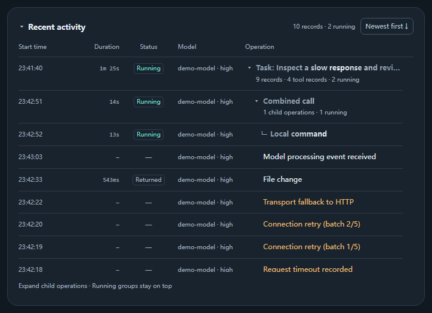
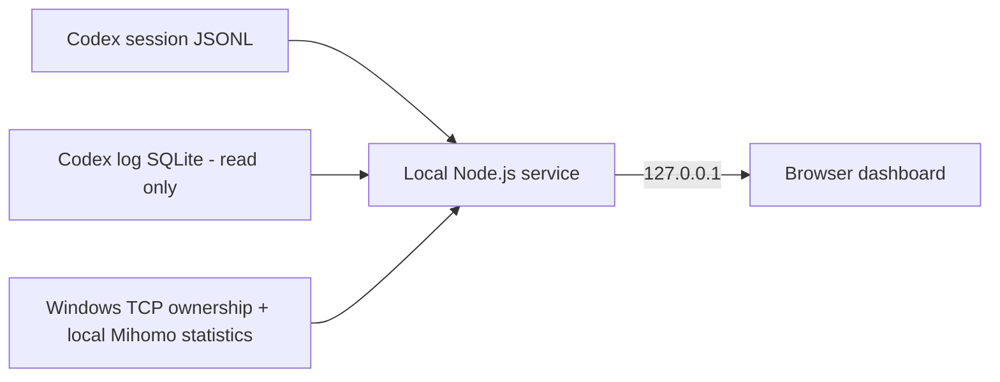

# Codex Runtime Monitor

[English](README.md) · [简体中文](README.zh-CN.md)

**Version: v0.1.4** · [Changelog](CHANGELOG.md) · [MIT License](LICENSE)

**See what Codex has recorded while you wait for a response.**

A local Windows dashboard for Codex session activity, task and tool-call timing, connection retries, transport fallbacks, and Codex proxy traffic. Built for investigating slow responses under unstable networks and other uncertain conditions.

The monitor runs independently of the agent loop: it reads existing local records and updates the dashboard without asking an agent to report its progress. No model calls, API key, or npm packages are required.



*Actual application UI rendered with synthetic demo data. Session names, model labels, timings and traffic values are illustrative; these images are not a network benchmark.*

<details>
<summary>Full dashboard: English / dark mode and Chinese / light mode</summary>


</details>

## Why this exists

I started this project after unstable network conditions made me question Codex's response speed. When the interface kept showing that it was thinking, I could not easily tell how long I had been waiting, whether new activity was arriving, or whether connection retries were happening.

I wanted a small tool that could keep observing local activity while I worked in PyCharm or another Codex client. This became Codex Runtime Monitor: a way to put recorded events, elapsed time and connection information in one place, so I could investigate a slow response with more evidence.

It helps establish what was observed. It does not automatically determine whether a delay comes from a mobile hotspot, a proxy, a remote service, model processing, or a tool.

## When it helps

| What you notice | What the monitor shows |
| --- | --- |
| A response takes longer than expected | Task elapsed time, first reply wait and time since the last recorded activity |
| A tool appears to be stuck | A live timer on its activity row, followed by its recorded final status |
| Connections seem unreliable | Timestamped retry, failure and WebSocket-to-HTTP/HTTPS fallback records |
| You want to inspect Codex proxy traffic | Upload/download rates, observed totals and a process-filtered history chart |
| Several tasks or calls overlap | Retained task groups, merged start/return rows and explicitly recorded parent/child relationships |

## Quick start

### Requirements

- **Windows**, with Windows PowerShell available. Other operating systems have not been validated.
- **Node.js 24.x**, available as `node` on your PATH. This version was checked locally with **Node.js 24.19.0** and its built-in `node:sqlite` module. Obtain Node.js from the [official download page](https://nodejs.org/en/download).
- A Codex client that writes readable session records under the monitored Codex home directory. PyCharm usage has been checked locally; compatibility depends on the records produced by the client.
- A browser. The launcher prefers Microsoft Edge and falls back to opening the local URL with the default browser.

For **proxy traffic statistics**, the current implementation additionally requires a local Clash Verge / Mihomo instance exposing a compatible Windows named pipe. Session activity and task timing remain available when traffic statistics are unavailable.

Codex CLI and desktop or IDE integrations must expose compatible local records; they have not all been separately validated.

### Run from source

1. Download the repository ZIP or clone it, then extract/open the folder containing `server.mjs`. Keep the application files together.

   ```powershell
   git clone https://github.com/ClencyX/codex-runtime-monitor.git
   cd codex-runtime-monitor
   ```
2. Open PowerShell in that folder and check Node.js:

   ```powershell
   node --version
   ```

3. Double-click **`启动监控.cmd`**, or run:

   ```powershell
   node --disable-warning=ExperimentalWarning server.mjs --open
   ```

4. If no window appears, open [http://127.0.0.1:47831/](http://127.0.0.1:47831/). Start or continue a Codex conversation, then select it in the dashboard. The latest ordinary session is followed by default.

There is no `npm install` step. The monitor can live outside any individual IDE project; an optional user-level location is `%USERPROFILE%\.codex\tools\codex-monitor`.

Use **Exit monitor** in the dashboard or `停止监控.cmd` to stop the service. Closing only the window leaves the monitor running. Exiting the monitor does not stop Codex or its tasks. Starting it again on the default port reuses a recognized running monitor.

### Choose a different Codex home

The discovery order is `CODEX_MONITOR_HOME`, then `CODEX_HOME`, then `%USERPROFILE%\.codex`. To set the location for a terminal session:

```powershell
$env:CODEX_MONITOR_HOME = 'D:\path\to\your\.codex'
node --disable-warning=ExperimentalWarning server.mjs --open
```

Point to the directory containing `sessions`, `session_index.jsonl` and, when available, `logs_*.sqlite`.

## Features

- **Task overview:** elapsed time, time since the latest recognizable activity, first reply wait, model and reasoning-effort labels when recorded.
- **Recent activity:** separate start time, duration, status, model and operation columns. Start/return records for the same call update one row. Running groups stay at the top in start order; other records support either time order.
- **Task history:** rounds already observed by the window remain grouped across later questions, refreshes and session switches. Only explicit parent identifiers create tool-call branches.
- **Connection details:** click retry, failure or fallback counters to expand timestamped summaries.
- **Termination reasons:** recorded interruptions are distinguished from success, with a reason such as usage limit, manual pause or a new turn replacing the previous one. Unknown reasons remain unknown.
- **Codex proxy traffic:** aggregate or per-process rates, observed byte totals, and 1/5/10/30-minute chart ranges. Missing samples remain unknown; dashed bridges are marked as unmeasured.
- **Display controls:** Chinese/English switching, light/dark themes, collapsible panels, sorting and width-based operation-text ellipsis. Running operations have a text shimmer.

Duration cells show milliseconds below one second, then completed integer seconds: `543ms`, `39s`, `3m 15s`, `1h 5m 39s` in English; `543 毫秒`, `39 秒`, `3 分 15 秒`, `1 小时 5 分 39 秒` in Chinese. Raw recorded millisecond information is retained. Live activity clocks refresh approximately every 100 ms; state records are polled approximately every second.

## Panel display order

Click **Arrange panels** in the top toolbar, beside the language and theme controls. Drag a row in the settings list or a panel's grip, or use the up/down buttons. A focused panel grip also supports the Up/Down arrow keys. Click **Done arranging** when finished; **Restore default order** restores the original layout. The session selector stays fixed at the top. The order is saved in this browser, survives reopening, and syncs between monitor windows on the same local address. Reordering preserves the existing cards, their disclosure state and table scroll positions.

## Account quota records

The collapsible quota panel shows 5-hour and weekly remaining balances with reset countdowns. Each progress bar and remaining-balance ring turns red-orange below 10% and returns to its normal color at 10% or above. When collapsed, it shows the previous turn's observed quota consumption and remaining-balance rings. A missing 5-hour window is hidden based on the returned data, not a guessed subscription rule.

Balances use local snapshots plus the official [`account/rateLimits/read`](https://learn.chatgpt.com/docs/app-server#6-rate-limits-chatgpt) method through an installed Codex executable and its existing sign-in. The monitor queries at most once per minute automatically; **Refresh quota** requests another read. It does not create a thread or invoke a model. Older, lower-usage log snapshots cannot roll a balance back within the same reset window; a fresh official query can apply a genuine correction. Update times remain visible. On failure, the last snapshot is retained with a notice. Set `CODEX_MONITOR_CODEX_BIN` to an executable path if autodetection fails, or `CODEX_MONITOR_QUOTA_DISABLED=1` to use logs only.

The selected session's latest 100 observed turns show differences between account snapshots near the turn boundaries. These are **observations, not exact per-turn billing**: concurrent sessions and other devices may contribute. Overlap is labelled; missing/stale boundaries, collection gaps and resets show unknown instead of invented percentages. `0%` means no observed percentage-point change. Recent records are reconstructed from bounded local log tails, so older records may be unavailable. Changing accounts can invalidate comparisons. No burn rate or token-to-quota conversion is displayed.

## How it works



The service incrementally reads session files and reads the local log database through a read-only SQLite connection. Traffic attribution matches Windows TCP ownership and proxy connection endpoints to `codex.exe` process identities, including process start time to distinguish reused PIDs.

The tool observes existing records. It does not start a new Codex App Server, intercept an agent conversation, or require a skill, subagent, custom agent entry point or agent-written heartbeat.

### Data handling

- The service binds to **`127.0.0.1`**. It sends no telemetry or model calls. Quota refresh asks the installed Codex process to query the official account service using its existing sign-in.
- It reads session JSONL, `session_index.jsonl`, the local `logs_*.sqlite` database, Windows connection ownership, and the local Mihomo statistics interface. It does not read `auth.json` or proxy subscriptions.
- **The local interface receives session names, full task prompt titles, working directories, model labels and derived event summaries.** The dashboard displays the session and task information it needs. Raw reasoning content, command arguments, tool output, request headers and raw proxy connection lists are not sent to the page.
- Observed task history is held in browser-window `sessionStorage`, with an in-memory fallback if storage is unavailable. Traffic history is held in service memory for up to 30 minutes and resets when the service restarts.
- Original Codex logs are not modified. Proxy settings and IDE configuration are not automatically changed. No packet-capture driver or administrator privileges are required by the application.

Review visible session names and prompt titles before sharing your own screenshots. The screenshots included here use synthetic data.

## Limits that matter

- **Recorded activity is not internal thinking progress.** No completion percentage or remaining-time estimate is inferred. Task steps are shown only when a structured plan was actually recorded.
- **A quiet dashboard does not identify the bottleneck.** Missing or delayed events cannot distinguish uploading, remote queueing, model processing and connection waits. A healthy local monitor does not establish that a remote connection is healthy.
- **Traffic is observed Codex proxy traffic.** It excludes unrelated programs, traffic bypassing the current proxy and separate processes launched by Codex. It is attributed to processes, not individual conversations sharing a process. Active-connection sampling can miss traffic, so totals are not billing-grade measurements.
- **History depends on available records.** Initial reading starts within the last 8 MB of a session file. An old start or end outside that window may remain unknown. The selector lists up to 50 ordinary sessions, with up to 50 internal review sessions optionally added; ordinary and internal discovery quotas are separate.
- **Client log formats can change.** Missing fields produce unknown or unavailable states. PyCharm-local chat renames may differ from the Codex session names used here.

## Troubleshooting

| Symptom | Check |
| --- | --- |
| `node` is not recognized or SQLite cannot be loaded | Install/use Node.js 24.x, verify `node --version`, and reopen the terminal after changing PATH. |
| No sessions appear | Check the monitored Codex home and whether the client has created readable `sessions` records. |
| Connection log database is unavailable | Session timing can still work. Check whether a readable `logs_*.sqlite` exists in the same Codex home. |
| Proxy traffic is unavailable | Check that the local Mihomo instance is running and exposes the supported Windows named pipe. Other dashboard functions remain usable. |
| A line in the chart is dashed | It connects available samples across a gap. The connecting section is not a measured rate. |
| The default port is occupied | Run `node --disable-warning=ExperimentalWarning server.mjs --port 47832 --open`. Use that window's **Exit monitor**; `停止监控.cmd` targets the default port only. |

For startup errors, run the server in a terminal so that its output remains visible. Detailed controls and timing rules are documented in [使用说明.md](使用说明.md).

## Development

The application uses Node.js built-ins, browser JavaScript/CSS, Windows PowerShell and a small C# connection sampler. No package installation or build step is required to run the current source.

```powershell
node --disable-warning=ExperimentalWarning --test
```

The local test run recorded on 2026-11-02 passed **97 tests** covering timing, task history, grouping, connection summaries, localization, traffic attribution and history, polling recovery, and local-server protections.

Main entry points: `server.mjs` (local service), `monitor-core.mjs` (record reduction), `app.js` / `activity-tree.js` (dashboard), and `network.mjs` / `network-history.mjs` / `network-chart.js` (traffic).

Report bugs through [GitHub Issues](https://github.com/ClencyX/codex-runtime-monitor/issues), including reproduction steps, Node.js version, client version, the affected dashboard section, and redacted screenshots or minimal synthetic records. Avoid posting raw session files or authentication data.

## Project status and license

This is an independent community project and is not an official OpenAI product. The current distribution is source-based; no packaged installer is included.

This project is open-source software released under the **standard MIT License**. Commercial use, modification, redistribution, sublicensing and selling copies are permitted, provided that the copyright notice and license notice are retained as required by the license. No additional restriction on paid redistribution is imposed. See [LICENSE](LICENSE) for the full terms.

The MIT license applies starting with v0.1.1. The existing v0.1.0 tag and source archives retain their original license text; use v0.1.1 or later for the MIT-licensed release.
