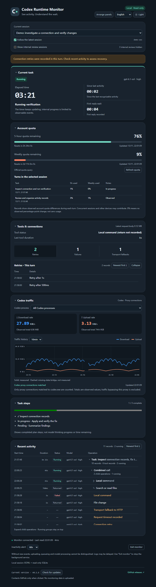
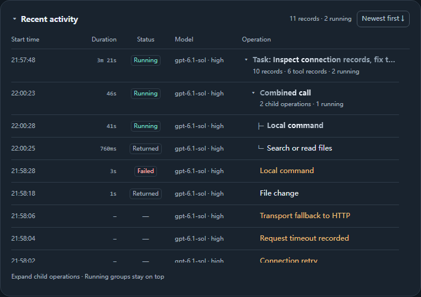
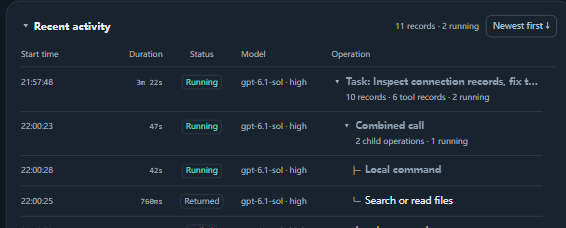
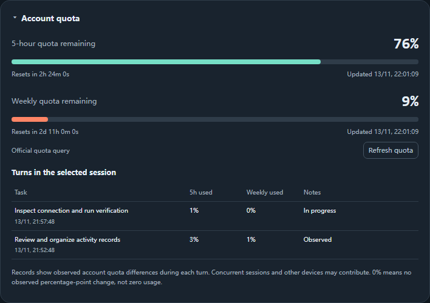
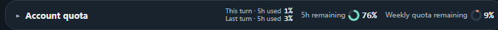
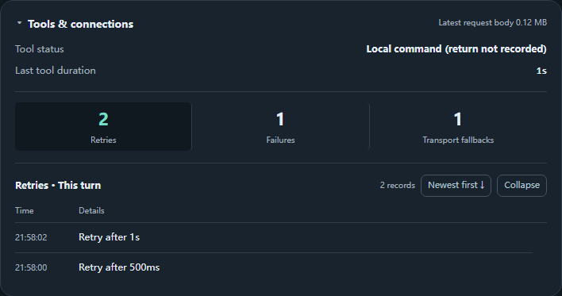
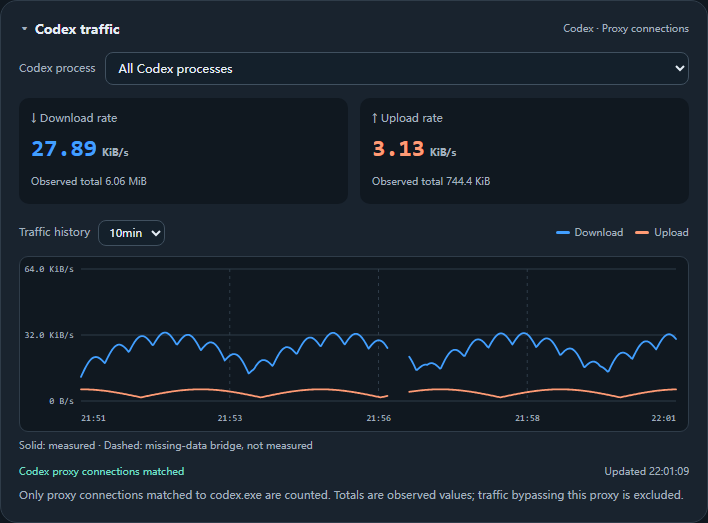
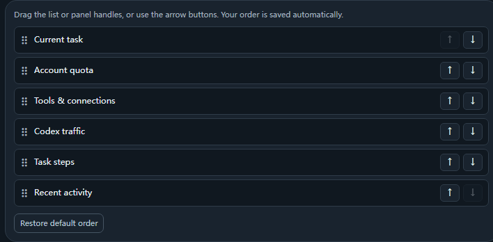
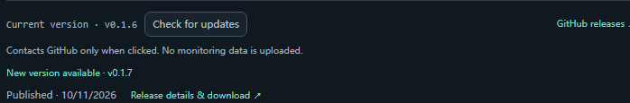
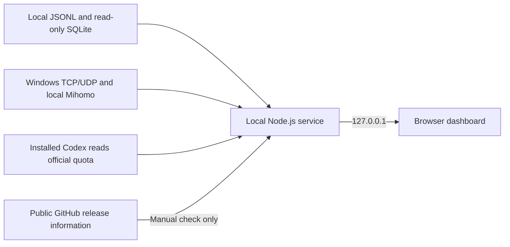

# Codex Runtime Monitor

**English** · [简体中文](README.zh-CN.md)

**v0.1.6** · Windows · No npm dependencies · [Changelog](CHANGELOG.md) · [MIT](LICENSE)

**When Codex keeps showing “Thinking,” see what was actually recorded while you waited.**

A local dashboard for Codex task timing, tool calls, connection retries, proxy traffic and account quota. It runs independently of the agent loop: no agent-written progress reports, API key or model calls are required.

## Full dashboard

[](docs/images/overview-en.png)

*Click an image for full size. All screenshots and animations use the actual application UI with synthetic demo data, not personal records. Quota, traffic, model labels and update results are illustrative, not benchmarks or claims about published releases. Task steps appear only when a structured plan was recorded.*

## Why this exists

I started this project after unstable network conditions made me question Codex's response speed. The interface kept showing that it was thinking, but I could not easily tell how long I had waited, whether new activity was arriving, or whether connections were being retried.

I wanted a small window beside PyCharm or another Codex client that could independently read local records and put those clues together. The monitor helps investigate a delay; it does not automatically attribute one to a mobile hotspot, proxy, remote service, model processing or tool execution.

## A note from the author

I am a university graduate who has just started working at a state-owned enterprise. It was only after I started working that I realized how many tasks I could use Codex to accomplish. Tools like Claude Code and Codex give everyone a great way to work, create, and pursue the things they enjoy. Since I plan to keep using Codex for the long term, I will also continue using and improving this simple Codex monitoring dashboard I have built. I hope everyone who comes across this project will support it. You can always get the latest version of this little tool, or clone the repository and adapt it to your own needs. Knowing that someone finds it useful is the greatest encouragement I could receive! Feedback and suggestions are always welcome!

## Quick start

### Requirements

| Component | Requirement |
| --- | --- |
| System | Windows with Windows PowerShell; other systems have not been validated |
| Runtime | Node.js 24.x available as `node`; locally checked with 24.19.0 and built-in `node:sqlite` |
| Session data | A Codex client writing readable local records under the monitored data directory; PyCharm usage has been checked locally |
| Browser | The launcher prefers an Edge app window, then attempts the default browser |
| Proxy traffic, optional | Local Clash Verge / Mihomo exposing a compatible Windows named-pipe statistics interface |
| Official quota, optional | An installed, signed-in, compatible Codex executable |

Get Node.js from its [official website](https://nodejs.org/en/download). Other local monitoring features remain available when proxy statistics or official quota reads are unavailable. Compatibility with Codex CLI, desktop and IDE integrations depends on their record formats; they have not all been separately validated.

### Download and launch

Download and extract the [latest stable source release](https://github.com/ClencyX/codex-runtime-monitor/releases/latest), or clone:

```powershell
git clone https://github.com/ClencyX/codex-runtime-monitor.git
cd codex-runtime-monitor
node --version
```

Double-click **`启动监控.cmd`**, or run in the application directory:

```powershell
node --disable-warning=ExperimentalWarning server.mjs --open
```

If no window appears, open <http://127.0.0.1:47831/>. Start or continue a Codex conversation and select it at the top. The latest ordinary session is followed by default.

**No `npm install` or build step.** Keep the complete application in any independent directory, such as `%USERPROFILE%\.codex\tools\codex-monitor`, for use across IDE projects.

Use **Exit monitor** or `停止监控.cmd` to stop the service. Closing only the window leaves it running. Exiting the monitor does not stop Codex or its tasks. Launching again on the default port reuses a recognized running monitor.

## Feature tour

### Task timing and recent activity

[](docs/images/activity-en.png)

- **Current task:** elapsed time, time since last activity, first reply wait, and recorded model and reasoning-effort labels.
- **Five-column activity table:** start time, duration, status, model and operation. Text is truncated to the actual column width; hover to read it in full.
- **One row per call:** a live timer updates until the return is recorded, then the same row shows the final state and duration. Running groups stay on top in start order; other rows support either time order.
- **Retained turns:** rounds observed by the window remain across later questions, refreshes and session switches. Branches use explicit parent identifiers, never guessed timing relationships.
- **Distinct end states:** completion, failure and termination remain separate, with a reason such as usage limit, manual pause or an inserted new turn when recorded. Incomplete timing stays unknown.
- **Unconfirmed completion:** an interrupted script host without an outer-call return gets an “Unconfirmed” state and a notice suggesting that you stop the task in the IDE before continuing. A later return can repair the same row.



*The combined call and its child return in place. Live duration labels refresh approximately every 100 ms, displaying completed integer seconds once a second is reached. Examples: `543ms`, `39s`, `3m 15s`, `1h 5m 39s`.*

### Account quota and observed turn consumption

[](docs/images/quota-expanded-en.png)

See 5-hour and weekly remaining balances, progress bars, reset countdowns and update times. Each quota window is independent: **below 10%, its bar and ring turn red-orange**. A missing 5-hour window is hidden based on returned data, not an assumed subscription rule.

[](docs/images/quota-collapsed-en.png)

The collapsed summary retains **this turn's usage, the last turn's usage and both balance rings**. Without a 5-hour window, the turn summaries use weekly quota.

Quota combines local snapshots with official account reads. The first query follows initial collection; subsequent automatic attempts are at least 60 seconds apart. **Refresh quota** has a 5-second cooldown and shares in-flight requests. On failure, the last snapshot remains visible with a notice.

Up to 100 recent turns in the selected session show **account snapshot differences**, not exact per-turn billing. Concurrent sessions and other devices may contribute. Missing or stale boundaries, incomplete collection and reset crossings remain unknown. `0%` means no observed percentage-point change, not zero usage.

### Connection retries, failures and transport fallbacks

[](docs/images/connections-en.png)

Click **Retries / Failures / Transport fallbacks** to expand a time/details list inside the panel. Switch categories, change time order and scroll through records. Safe summaries include retry intervals, timeout reasons or HTTP status codes when logged.

Counters count log records, not necessarily independent network incidents. An absence of error records does not establish a healthy connection.

### Codex proxy traffic

[](docs/images/traffic-en.png)

Windows TCP/UDP endpoint ownership and local Mihomo statistics are matched to `codex.exe`. Protocol, local address and port are checked separately for TCP and UDP; confirmed Codex UDP traffic is included. Ambiguous shared UDP endpoints remain unattributed. View upload/download rates, observed totals and **1 / 5 / 10 / 30-minute** history across all Codex processes or one PID. Process start times distinguish reused PIDs.

Blue represents downloads; orange represents uploads. Hover, or focus the chart and use arrow keys, to inspect samples. Moving the pointer away hides the tooltip. **Solid lines show measurements; dashed bridges cross missing samples and are not measured rates.** Unknown values are not filled with zero. History is retained for up to 30 minutes and starts again when the service restarts.

Coverage is limited to matched Codex proxy connections. It excludes unrelated programs, traffic bypassing the proxy and separate child processes launched by Codex. Conversations sharing a process cannot be split apart. Active-connection sampling can miss traffic, so totals are not billing-grade measurements.

### Language, themes, disclosure and panel order

[](docs/images/arrange-en.png)

- Switch **Chinese / English** and light/dark themes in the top toolbar. Translation uses a local dictionary, without an external service. Session names, prompts and plan steps retain their original language.
- Collapse any panel except the session selector. Collection and timing continue; expanding it restores reading positions.
- Click **Arrange panels** to drag list items or panel handles, or use the up/down buttons and keyboard arrows on a focused handle. The session selector stays fixed at the top.
- Theme, language and order persist in the browser and sync between windows on the same local address. Task history and disclosure use window-level storage, with an in-memory fallback.

### Manual update checks

[](docs/images/updates-en.png)

The footer shows the local version. **Only clicking Check for updates** contacts GitHub for public stable-release information, compares versions locally and provides a publication date and release/download link. Startup and background operation do not automatically check for updates.

No GitHub login or token is required. The local version, sessions and monitoring records are not uploaded. Repeated clicks share the in-flight request or reuse its result for 30 seconds. Timeouts and network failures are errors, never “up to date.” Downloading and replacing files remain manual.

Comparison supports stable `major.minor.patch` versions. **A code patch under the same version number cannot be distinguished by version comparison.** To update, stop the monitor and extract the new source into a new directory. Keep the old directory for rollback.

## Data and network behavior

**Monitoring data stays on your machine. This tool does not upload collected conversation content, task records, tool-call records, working directories or traffic statistics, and collects no telemetry.**

| Feature | Source and network behavior |
| --- | --- |
| Sessions, activity, timing and plans | Incremental reads of local JSONL and read-only SQLite logs |
| Proxy traffic | Windows TCP/UDP endpoint ownership and the local Mihomo named pipe; no proxy subscription access |
| Official quota refresh | A short-lived Codex App Server subprocess uses the existing sign-in and `account/rateLimits/read` to query the official account service; no thread creation or model call |
| Update check | User-triggered anonymous GET to `api.github.com/repos/ClencyX/codex-runtime-monitor/releases/latest`, reading public Release information |
| Release and download links | Opened by the user in the browser, which then accesses GitHub |

Remote requests carry normal network information, such as the egress IP and necessary headers. Official quota reads also involve Codex authentication. This promise concerns data collected by the monitor, not the Codex client's own network behavior.

The local service binds only to **`127.0.0.1`**. UI assets and translations load locally. It does not read `auth.json`, take over conversations, or require a skill, subagent, custom entry point or agent-written heartbeat. Original logs, IDE settings and proxy configuration are not modified. The application needs no administrator privileges or packet-capture driver.

The local interface returns session names, full task prompt titles, working directories, model labels and event summaries to the browser. It does not return raw reasoning, command arguments, tool output, request headers or raw proxy connection lists. Review visible titles and paths before sharing screenshots.

## How it works and its limits



**Recorded activity is not internal thinking progress.** No thinking percentage or remaining-time estimate is inferred. The task-steps bar represents a recorded plan only. First reply wait and quiet periods are also affected by log-write timing.

**A quiet dashboard does not locate the bottleneck.** Missing or delayed events cannot distinguish uploading, remote queueing, model processing and connection waits. A healthy monitor means its local interface is refreshing.

Initial reads are bounded to the last 8 MB of a session file; earlier boundaries may be unavailable. Window-retained history is not complete account history. The selector shows up to 50 ordinary sessions and optionally another 50 internal review sessions. PyCharm-local renames may differ from the Codex session titles used here.

Client record formats can change; missing fields remain unknown or unavailable. Without explicit parent identifiers, a combined call cannot be reliably subdivided into inferred children.

## Configuration and troubleshooting

| Environment variable | Purpose |
| --- | --- |
| `CODEX_MONITOR_HOME` | Data directory, ahead of `CODEX_HOME`; defaults to `%USERPROFILE%\.codex` |
| `CODEX_MONITOR_CODEX_BIN` | Codex executable for official quota reads |
| `CODEX_MONITOR_QUOTA_DISABLED=1` | Disable proactive official quota reads and use quota logs only; manual update checks remain available |

```powershell
$env:CODEX_MONITOR_HOME = 'D:\path\to\your\.codex'
node --disable-warning=ExperimentalWarning server.mjs --port 47832 --open
```

The data directory should contain `sessions`, `session_index.jsonl` and, when available, `logs_*.sqlite`.

| Symptom | Check |
| --- | --- |
| `node` missing or SQLite cannot load | Check Node.js 24.x and `node --version`; reopen the terminal after PATH changes |
| No sessions | Check the data directory and whether the client creates readable records |
| Connection logs unavailable | Check local `logs_*.sqlite`; session timing may still work |
| Proxy traffic unavailable | Check Mihomo and its compatible named pipe; whole-system traffic is never substituted |
| Quota differs from the web or is unavailable | Check update times, refresh manually and verify local Codex sign-in; failures retain the last snapshot |
| Update check fails | Check connectivity to GitHub, or open releases in your browser; proxy settings are not changed |
| Default port occupied | Use `--port 47832` and that window's Exit monitor; `停止监控.cmd` targets the default port only |

Run `server.mjs` in a terminal to retain startup errors. [使用说明.md](使用说明.md) provides more controls and an optional PyCharm menu entry in Chinese.

## Development and feedback

The source uses Node.js built-ins, browser JavaScript/CSS, PowerShell and a small C# connection sampler. There is no dependency installation or build step.

```powershell
node --disable-warning=ExperimentalWarning --test --test-concurrency=1
```

Tests cover timing, history, parent/child calls, interruptions, connection summaries, localization, quota, traffic attribution, polling recovery, local endpoint protections and update checks. Regenerate documentation images on Windows with Edge:

```powershell
node docs/render-screenshots.mjs
```

The generator uses an isolated temporary headless browser and local synthetic records. It does not read personal browser profiles or sessions, query real quota, or contact GitHub. The example newer version in screenshots is not a published-release claim.

Main entry points: `server.mjs` (service), `monitor-core.mjs` (logs), `app.js` / `activity-tree.js` (activity UI), `network*.mjs/js` (traffic), `quota*.mjs/js` (quota), and `update.mjs` / `update-ui.js` (update checks).

Report bugs through [GitHub Issues](https://github.com/ClencyX/codex-runtime-monitor/issues), with reproduction steps, environment details and redacted screenshots. Do not submit raw session files or authentication data.

## License and project status

An independent community project, not an official OpenAI product. Distribution is currently source-based, without a packaged installer.

Version v0.1.1 and later use the standard [MIT License](LICENSE), permitting commercial use, modification and redistribution, including selling copies, with required copyright and license notices. Historical v0.1.0 archives retain their original license text.
