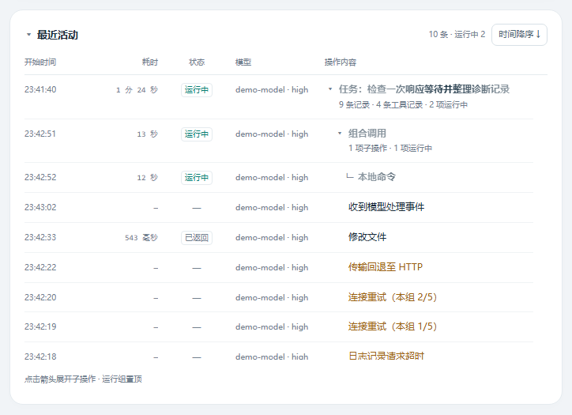
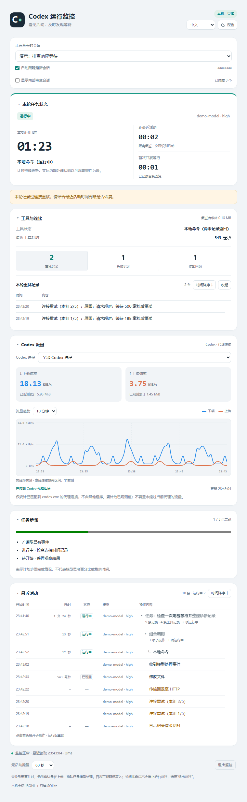
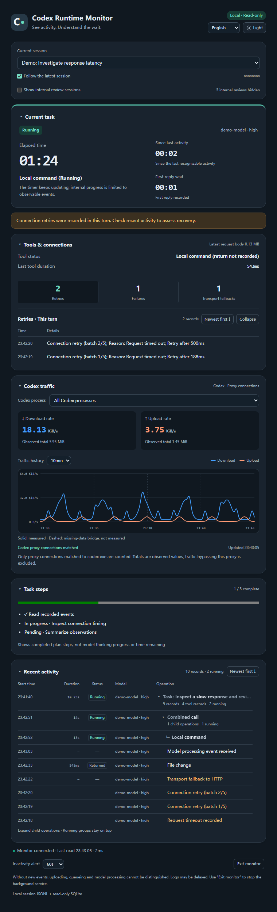
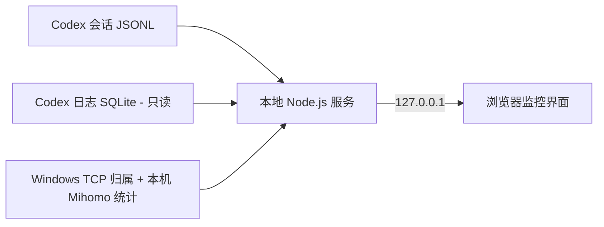

# Codex 运行监控

[English](README.md) · [简体中文](README.zh-CN.md)

**版本：v0.1.1** · [更新记录](CHANGELOG.md) · [MIT 许可证](LICENSE)

**让等待 Codex 回复的过程，有可查看的活动记录。**

面向 Windows 的本地 Codex 运行监控与排障工具。集中查看任务耗时、工具调用、连接重试、传输回退和 Codex 代理流量，帮助你在网络条件不稳定或其他原因不明的响应变慢时，获得更多判断依据。

工具独立于智能体执行循环运行：读取已有本地记录并持续更新界面，无需让智能体主动汇报进度。运行时无需模型调用、API Key 或 npm 依赖包。



*截图使用现有程序界面和合成演示数据。会话名、模型标签、耗时及流量数字均用于展示，不代表实际网络性能测试结果。*

<details>
<summary>查看完整界面：中文浅色 / 英文深色</summary>





</details>

## 为什么做这个工具

这个项目起于我对 Codex 响应速度的一次疑问。

在网络条件不稳定的环境中使用 Codex 时，我遇到过回复明显变慢的情况。界面持续显示“正在思考”，但我很难直观看出自己已经等了多久、期间是否出现了新活动，以及连接有没有发生重试。

我希望有一个小工具，能在我使用 PyCharm 或其他 Codex 客户端时，独立观察本地记录，把任务耗时、工具活动和连接信息放在一起。这样再次遇到响应变慢时，就能先看记录，再逐步排查。

因此有了 Codex 运行监控。它提供可观测的线索，但不会直接把延迟判定为手机热点、网络代理、远端服务、模型处理或工具执行中的某一个原因。

## 适合什么场景

| 遇到的问题 | 可以查看的信息 |
| --- | --- |
| 回复比预期慢，不知道已经等了多久 | 本轮用时、首次回复等待、距最近活动时间 |
| 不确定某个工具是否还在执行 | 同一行中的实时计时、返回状态和最终耗时 |
| 怀疑连接反复超时或回退 | 重试、失败、WebSocket 转 HTTP/HTTPS 的时间与详情 |
| 想了解 Codex 的代理流量变化 | 上传下载速率、已观测累计、按进程筛选的趋势图 |
| 多轮任务或多个调用交叉出现 | 保留的任务分组、合并的调用记录、明确的父子关系 |

## 快速开始

### 环境要求

- **Windows**，可使用 Windows PowerShell。其他操作系统尚未验证。
- **Node.js 24.x**，且可以在终端通过 `node` 调用。本机已使用 **Node.js 24.19.0** 及其内置 `node:sqlite` 模块验证。可从 [Node.js 官方下载页](https://nodejs.org/en/download) 获取。
- Codex 客户端会在所监控的目录中生成可读取的本地会话记录。已在本机 PyCharm 使用场景中验证；具体兼容性取决于客户端生成的记录。
- 浏览器。启动器优先使用 Microsoft Edge 独立窗口，找不到时尝试通过默认浏览器打开本地地址。

**代理流量统计另有条件：**当前实现需要本机运行 Clash Verge / Mihomo，并提供兼容的 Windows 命名管道统计接口。流量统计不可用时，会话活动和任务计时仍可使用。

Codex CLI、桌面端和不同 IDE 集成均需生成兼容的本地记录，目前没有对所有客户端分别完成验证。

### 从源码启动

1. 下载仓库 ZIP 并解压，或克隆仓库，进入包含 `server.mjs` 的目录。保持程序文件完整。

   ```powershell
   git clone https://github.com/ClencyX/codex-runtime-monitor.git
   cd codex-runtime-monitor
   ```
2. 在该目录打开 PowerShell，检查 Node.js：

   ```powershell
   node --version
   ```

3. 双击 **`启动监控.cmd`**，或运行：

   ```powershell
   node --disable-warning=ExperimentalWarning server.mjs --open
   ```

4. 若窗口未出现，打开 [http://127.0.0.1:47831/](http://127.0.0.1:47831/)。开始或继续一段 Codex 对话，在顶部选择对应会话。默认自动跟随最新活动的普通会话。

无需执行 `npm install`。程序可以放在任意独立目录，不依赖某个 PyCharm 项目；也可以放在用户级目录 `%USERPROFILE%\.codex\tools\codex-monitor` 中共用。

通过窗口中的 **退出监控** 或 `停止监控.cmd` 结束服务。仅关闭窗口会保留后台监控。退出监控不会停止 Codex 或正在执行的任务；默认端口已有本工具服务时，再次启动会复用它。

### 指定其他 Codex 数据目录

依次采用 `CODEX_MONITOR_HOME`、`CODEX_HOME`、`%USERPROFILE%\.codex`。可以仅为当前终端指定：

```powershell
$env:CODEX_MONITOR_HOME = 'D:\path\to\your\.codex'
node --disable-warning=ExperimentalWarning server.mjs --open
```

该目录下应有 `sessions`、`session_index.jsonl`，以及可用时的 `logs_*.sqlite`。

## 主要功能

- **任务概览：**本轮耗时、距最近活动、首次回复等待，以及记录中存在的模型与思考档位。
- **最近活动：**开始时间、耗时、状态、模型、操作内容分别成列。同一调用的开始和返回合并为一行；运行组按开始顺序置顶，其他记录可切换时间升降序。
- **任务历史：**本窗口已观察到的轮次在新一轮开始后继续保留，支持刷新和会话切换。只有记录中明确提供父操作标识时才绘制调用树枝。
- **连接明细：**点击重试、失败或传输回退数字，展开对应时间与摘要。
- **终止原因：**区分正常完成与任务终止，显示日志中可识别的额度耗尽、手动暂停、新一轮插入等原因，无法确认时保持未知。
- **Codex 代理流量：**全部或单进程速率、已观测累计、1/5/10/30 分钟趋势。缺失采样保持未知，虚线连接段标注为非实测。
- **显示控制：**中英文切换、深浅色模式、面板折叠、排序、按列宽省略过长文字，以及运行中操作的文字扫光。

耗时不足一秒显示毫秒，达到一秒后显示已走完的整数秒。中文示例：`543 毫秒`、`39 秒`、`3 分 15 秒`、`1 小时 5 分 39 秒`；英文示例：`543ms`、`39s`、`3m 15s`、`1h 5m 39s`。底层保留记录已有的毫秒信息。活动读秒约每 100 毫秒刷新，状态记录约每秒读取。

## 工作原理



后台增量读取已有会话文件，并通过只读 SQLite 连接获取连接日志。流量统计将 Windows TCP 连接归属与代理连接端点匹配到 `codex.exe`，同时使用进程启动时间区分 PID 复用。

工具观察的是已有记录，不启动新的 Codex App Server，不接管对话，也不要求配置 Skill、Subagent、自定义智能体入口或由智能体写入心跳。

### 数据如何处理

- 服务仅绑定 **`127.0.0.1`**。程序没有遥测、面向远端服务的请求或模型调用。
- 读取会话 JSONL、`session_index.jsonl`、本地 `logs_*.sqlite`、Windows 连接归属及本机 Mihomo 统计接口。不读取 `auth.json` 或代理订阅。
- **本地接口会返回会话名、完整任务提问标题、工作目录、模型标签和事件摘要，界面按需展示会话与任务信息。**不向页面发送原始推理正文、命令参数、工具输出、HTTP 请求头或代理连接原始列表。
- 已观察到的任务历史保存在浏览器窗口级 `sessionStorage`，存储不可用时回退到当前页面内存。流量历史在服务内存中最多保留 30 分钟，服务重启后重新积累。
- 不修改 Codex 原始日志，不自动更改代理或 IDE 配置。应用本身无需管理员权限或抓包驱动。

分享自己的截图前，请检查可见的会话名和提问标题。本文截图全部使用合成演示数据。

## 使用边界

- **活动记录不等于模型内部思考进度。**不推算完成百分比或剩余时间；只有记录中确实存在结构化计划时才展示步骤完成情况。
- **没有新活动不能直接定位瓶颈。**事件缺失或写入延迟时，无法区分上传、远端排队、模型处理与连接等待。“监控正常”仅表示本地监控正常更新。
- **流量是已观测的 Codex 代理流量。**不含其他程序、绕过当前代理的流量，或 Codex 启动的独立子进程流量；按进程归属，不按共用进程中的不同对话拆分。活动连接采样存在漏计可能，累计不作为精确账单。
- **历史取决于可读取的记录。**启动时从会话文件末尾最多 8 MB 开始回读，更早的起止事件可能无法获取。选择列表最多展示 50 个普通会话，按需额外展示 50 个内部审查会话，两类发现名额独立保留。
- **客户端日志格式可能变化。**缺少字段时显示未知或不可用。PyCharm 内部重命名的对话名，可能与本工具采用的 Codex 会话名不同。

## 常见问题

| 现象 | 检查方式 |
| --- | --- |
| 找不到 `node` 或无法加载 SQLite | 使用 Node.js 24.x，执行 `node --version`；修改 PATH 后重新打开终端。 |
| 找不到会话 | 检查监控的数据目录，以及客户端是否已生成可读取的 `sessions` 记录。 |
| 连接日志数据库不可用 | 会话计时仍可能正常；检查同一 Codex 数据目录中是否有可读取的 `logs_*.sqlite`。 |
| 代理流量不可用 | 检查本机 Mihomo 是否运行并提供支持的 Windows 命名管道；其他监控功能仍可使用。 |
| 趋势图出现虚线 | 该段连接缺失区间两侧的有效样本，虚线本身不是实测速率。 |
| 默认端口被占用 | 运行 `node --disable-warning=ExperimentalWarning server.mjs --port 47832 --open`；使用对应窗口中的“退出监控”，`停止监控.cmd` 仅针对默认端口。 |

排查启动失败时，在终端直接运行服务以查看错误输出。更详细的操作与计时规则见 [使用说明.md](使用说明.md)。

## 开发与验证

当前实现使用 Node.js 内置模块、浏览器 JavaScript/CSS、Windows PowerShell 和少量 C# 连接采样代码。运行源码无需安装依赖包或执行构建。

```powershell
node --disable-warning=ExperimentalWarning --test
```

2026-11-02 的本机验证记录中，**97 项测试全部通过**，覆盖任务计时、轮次历史、调用分组、连接摘要、中英文显示、流量归属与历史、轮询恢复和本地服务防护。

主要入口：`server.mjs` 负责本地服务，`monitor-core.mjs` 处理记录，`app.js` / `activity-tree.js` 展示界面，`network.mjs` / `network-history.mjs` / `network-chart.js` 处理流量。

可通过 [GitHub Issues](https://github.com/ClencyX/codex-runtime-monitor/issues) 反馈问题，建议提供复现步骤、Node.js 版本、客户端版本、受影响的界面区域，以及脱敏截图或最小合成记录。请避免直接提交原始会话文件或认证信息。

## 项目状态与许可证

这是独立的社区项目，并非 OpenAI 官方产品。当前以源码运行，目录中尚未提供打包安装程序。

本项目采用**标准 MIT 许可证**开源。允许商业使用、修改、分发、再许可及销售软件副本，按许可证要求保留版权声明和许可声明即可；不附加禁止收费分发条款。完整条款见 [LICENSE](LICENSE)。

自 v0.1.1 起采用 MIT 许可证。已发布的 v0.1.0 标签和源码归档保留原有许可证文本；需要 MIT 许可版本时，请使用 v0.1.1 或更新版本。
