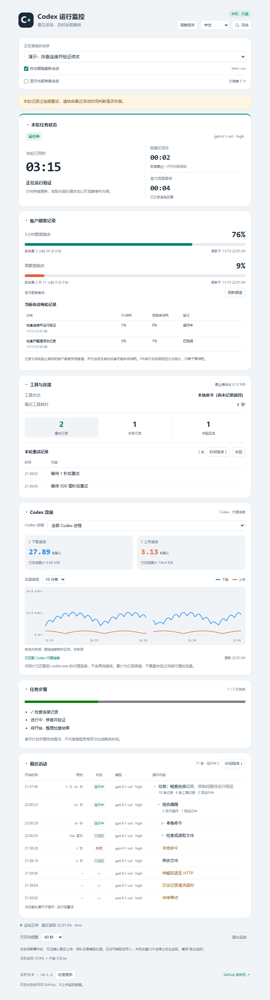
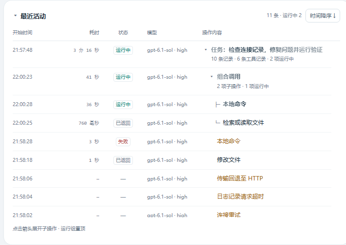
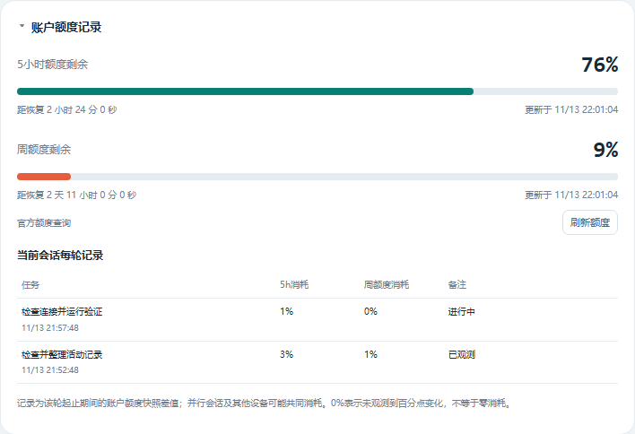
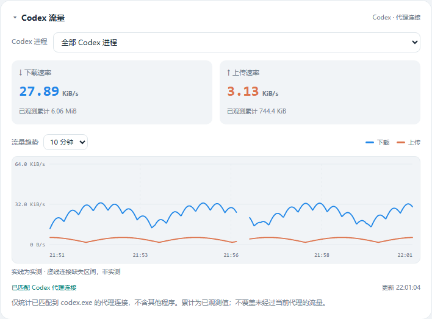
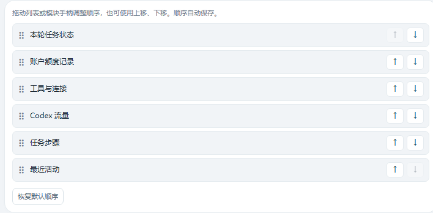
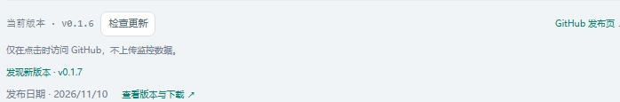
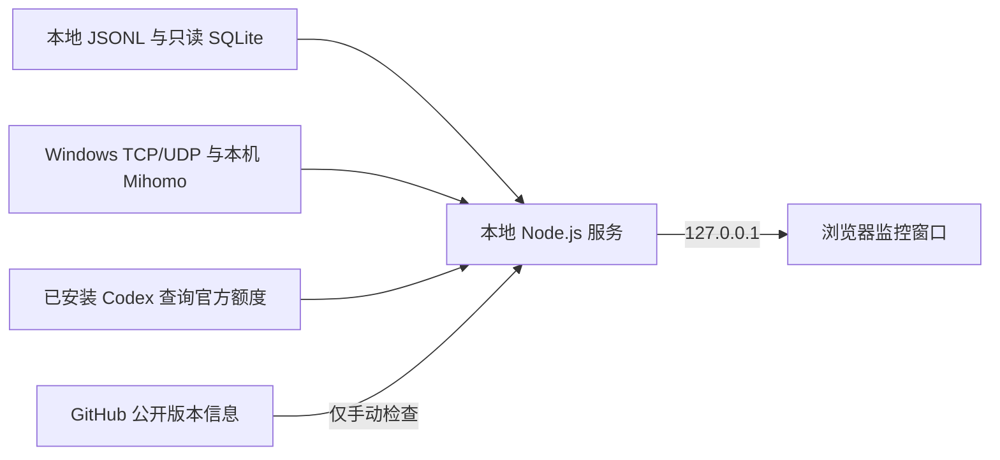

# Codex 运行监控

[English](README.md) · **简体中文**

**v0.1.6** · Windows · 无 npm 依赖 · [更新记录](CHANGELOG.md) · [MIT](LICENSE)

**Codex 一直显示“正在思考”时，看看这段等待期间实际记录了什么。**

独立于智能体执行循环的本地监控窗口，集中展示 Codex 任务耗时、工具调用、连接重试、代理流量和账户额度。无需让智能体汇报进度，无需 API Key，也不调用模型。

## 完整界面

[](docs/images/overview-zh.png)

*点击图片查看原图。本文所有截图和动画均由真实程序界面与合成演示数据生成，不包含个人会话记录。额度、流量、模型标签和版本结果仅用于演示，不代表性能测试或实际发布状态。任务步骤只在日志记录了结构化计划时出现。*

## 为什么开发

这个项目起于我对 Codex 响应速度的一次疑问。

在网络条件不稳定的环境中使用 Codex 时，我遇到过回复明显变慢的情况。界面持续显示“正在思考”，但我很难直观看出自己已经等了多久、期间是否有新活动，以及连接有没有发生重试。

我希望在 PyCharm 或其他 Codex 客户端旁边放一个小窗口，独立读取本地记录，把这些线索集中起来。因此有了这个工具。它帮助观察和排查，但不会直接判定延迟来自手机热点、网络代理、远端服务、模型处理或工具执行中的哪一项。

## 声明

我是一个刚刚加入国企工作的大学生，参加工作了以后才发现许多的工作可以使用Codex也能做到用Codex完成。Claude Code和Codex这类工具给了所有人无论是工作还是创造还是做自己喜欢的事一种很好的工具。因为我今后也会长期使用Codex，进而我会持续使用和改进我目前开发的这款简易版本的Codex监控台。所以我希望走过路过的大家多多支持一下我的项目，大家可以随时获取我最新更新的这款小工具，也可以克隆仓库并改进为适合自己用的工具，只要有人能用得上就是对我最大的鼓励！欢迎大家提出意见！

## 快速开始

### 环境要求

| 项目 | 要求 |
| --- | --- |
| 系统 | Windows，可使用 Windows PowerShell；其他系统尚未验证 |
| 运行时 | Node.js 24.x，终端可以执行 `node`；本机验证使用 24.19.0 及内置 `node:sqlite` |
| 会话数据 | Codex 客户端在所监控的数据目录中写入可读记录；已在本机 PyCharm 场景验证 |
| 浏览器 | 启动器优先使用 Edge 独立窗口，否则尝试默认浏览器 |
| 代理流量（可选） | 本机 Clash Verge / Mihomo 提供兼容的 Windows 命名管道统计接口 |
| 官方额度（可选） | 本机已安装、已登录的兼容 Codex 可执行文件 |

Node.js 可从[官方网站](https://nodejs.org/en/download)获取。流量统计或官方额度不可用时，其他本地监控功能仍可使用。不同 Codex CLI、桌面端及 IDE 集成的兼容性取决于实际日志格式，尚未逐一验证。

### 下载并启动

下载[最新正式版源码](https://github.com/ClencyX/codex-runtime-monitor/releases/latest)并解压，或执行：

```powershell
git clone https://github.com/ClencyX/codex-runtime-monitor.git
cd codex-runtime-monitor
node --version
```

双击 **`启动监控.cmd`**，或在程序目录执行：

```powershell
node --disable-warning=ExperimentalWarning server.mjs --open
```

若窗口未出现，打开 <http://127.0.0.1:47831/>。开始或继续一段 Codex 对话，在顶部选择对应会话；默认自动跟随最新活动的普通会话。

**无需 `npm install` 或构建。**完整程序可保存在任意独立目录，例如 `%USERPROFILE%\.codex\tools\codex-monitor`，供不同 PyCharm 项目共用。

使用窗口底部的 **退出监控** 或 `停止监控.cmd` 停止服务。只关闭窗口会保留后台服务；退出监控不会结束 Codex 或其任务。默认端口已有本工具服务时，再次启动会复用它。

## 功能图解

### 任务计时与最近活动

[](docs/images/activity-zh.png)

- **本轮状态**：总用时、距最近活动、首次回复等待，以及日志提供的模型和思考档位。
- **五列活动表格**：开始时间、耗时、状态、模型和操作内容。长内容按实际列宽省略，悬停可查看完整文字。
- **同一调用只占一行**：开始后实时读秒，收到返回时在原行更新状态和最终耗时。运行组按开始顺序置顶，其余记录可切换时间升降序。
- **保留多轮任务**：本窗口观察到的轮次在后续提问、刷新和会话切换后继续保留。只有明确的父操作标识才绘制树枝，不根据时间重叠猜测关系。
- **区分结束情况**：正常完成、失败、任务终止分别展示；可识别时注明额度耗尽、手动暂停、新对话插入等原因。缺失起止记录显示“耗时未知”。
- **提示异常等待**：脚本执行环境记录中断、外层调用没有返回时，显示“结束未确认”，并提示在 IDE 中终止当前任务后继续。后来收到返回仍可修复原行。


*组合调用和子调用在原行从“运行中”变为“已返回”。活动计时文字约每 100 毫秒刷新，满一秒后显示已走完的整数秒。示例：`543 毫秒`、`39 秒`、`3 分 15 秒`、`1 小时 5 分 39 秒`。*

### 账户额度与每轮观测记录

[](docs/images/quota-expanded-zh.png)

同时展示 5 小时与周额度剩余百分比、进度条、恢复倒计时和更新时间。两种额度独立判断：**剩余低于 10% 时，对应进度条和圆环变为红橙色**。服务未提供 5 小时窗口时隐藏该项，不根据套餐名称推测。

[](docs/images/quota-collapsed-zh.png)

折叠后保留**本轮消耗、上一轮消耗、5h 剩余和周额度剩余**。没有 5 小时窗口时，消耗摘要使用周额度。

额度结合本地快照与官方账户查询：首次采集后查询，后续自动查询间隔至少 60 秒；“刷新额度”有 5 秒冷却。同一请求不会重复发起，查询失败时保留旧快照并提示。

每轮记录是所选会话起止期间的**账户额度快照差值**，最多展示最近 100 轮，并非精确单轮计费。并行会话及其他设备可能共同消耗；快照缺失、过旧、采集不完整或跨恢复时显示未知。`0%` 表示未观测到百分点变化，不等于零消耗。

### 连接重试、失败与传输回退

[](docs/images/connections-zh.png)

点击 **重试记录 / 失败记录 / 传输回退** 数字，在原面板下展开“时间 / 内容”记录。可切换类别、调整时间顺序或滚动查看。日志存在时展示重试间隔、超时原因或 HTTP 状态等安全摘要。

数字代表日志记录数量，不一定等于独立网络故障次数。“没有错误记录”也不能证明连接没有问题。

### Codex 代理流量趋势

[](docs/images/traffic-zh.png)

通过 Windows TCP/UDP 端点归属与本机 Mihomo 统计匹配 `codex.exe`，分别按协议、本地地址和端口匹配，确认属于 Codex 的 UDP 流量正常计入；共享 UDP 端口无法唯一确认归属时不猜测。展示上传下载速率、已观测累计和最近 **1 / 5 / 10 / 30 分钟**趋势。支持全部进程或单个 PID，使用进程启动时间区分 PID 复用。

蓝色为下载，橙色为上传；悬停或聚焦后使用方向键查看样本，鼠标离开后隐藏浮层。**实线表示实测，虚线跨接缺失区间，虚线本身不是实测速率。**未知值不会填成零。历史最多保留 30 分钟，服务重启后重新积累。

只覆盖已匹配的 Codex 代理连接，不含其他程序、绕过当前代理的流量或 Codex 启动的独立子进程。多个对话共用进程时无法按对话拆分。活动连接采样可能漏计，累计不作为精确账单。

### 语言、主题、折叠与模块顺序

[](docs/images/arrange-zh.png)

- 右上角切换 **中文 / English** 和深浅色模式。翻译使用本地词典，不调用外部服务；会话名、提问和计划步骤保留原文。
- 除会话选择外，各模块均可折叠，采样与计时继续。再次展开保留阅读位置。
- 点击 **调整顺序**，拖动设置条目或模块手柄，也可使用 ↑ / ↓ 或手柄上的键盘方向键。会话选择固定在顶部。
- 主题、语言和模块顺序保存在当前浏览器，同一本机地址的窗口同步；任务历史与折叠状态采用窗口级存储。存储不可用时退回页面内存。

### 手动检查更新

[](docs/images/updates-zh.png)

窗口底部显示本地版本。**仅点击“检查更新”时**，服务才向 GitHub 查询公开的最新正式版信息，在本地比较版本并提供发布日期、版本详情与下载入口。启动或后台运行不会自动检查更新。

不需要 GitHub 登录或 Token，不上传本地版本、会话或监控记录。重复点击共享进行中的请求，30 秒内复用结果；超时或网络错误明确提示，不将失败当作“已经是最新版”。下载与替换由用户操作，没有自动安装。

版本比较识别正式版的 `主版本.次版本.补丁版本`。**同一版本号下的代码修补无法靠版本号识别。**更新时先停止监控，再将新版源码解压到新目录运行；保留原目录即可回退。

## 数据与网络行为

**监控数据保留在本机。本工具不会上传采集到的会话内容、任务记录、工具调用记录、工作目录或流量统计，不收集遥测数据。**

| 功能 | 数据来源与联网行为 |
| --- | --- |
| 会话、活动、计时与计划 | 增量读取本地 JSONL，以及只读 SQLite 日志 |
| 代理流量 | Windows TCP/UDP 端点归属及本机 Mihomo 命名管道统计，不访问代理订阅 |
| 官方额度刷新 | 启动短时 Codex App Server 子进程，通过 `account/rateLimits/read` 使用已有登录态查询官方账户服务；不创建对话、不调用模型 |
| 检查更新 | 用户点击后匿名 GET `api.github.com/repos/ClencyX/codex-runtime-monitor/releases/latest`，读取公开 Release 信息 |
| 发布页与下载链接 | 用户打开后由浏览器访问 GitHub |

远端请求会携带正常网络请求信息，例如出口 IP 和必要的请求头；官方额度请求涉及 Codex 自身的身份认证。上述承诺针对监控工具采集的数据，并不代表 Codex 客户端本身不联网。

本地服务仅监听 **`127.0.0.1`**，界面资源和翻译从本机加载。不读取 `auth.json`，不接管已有对话，也不要求 Skill、Subagent、自定义入口或智能体心跳。不改写原始会话日志、IDE 或代理设置，应用本身无需管理员权限或抓包驱动。

本地接口会向浏览器返回会话名、完整任务标题、工作目录、模型标签和事件摘要；不返回原始推理正文、命令参数、工具输出、请求头或代理连接原始列表。分享截图前请检查可见标题与路径。

## 工作原理与边界



**活动记录不是模型内部思考进度。**不推算思考百分比或剩余时间。任务步骤条仅表示已记录计划的完成情况；首次回复等待和安静时长也受日志写入时机影响。

**安静的窗口不能直接定位瓶颈。**事件缺失或延迟时，无法区分上传、远端排队、模型处理和连接等待。“监控正常”只表示本地接口正常刷新。

初始读取限于会话文件末尾最多 8 MB，更早的起止事件可能无法恢复。窗口保留的任务历史不等于完整账户历史。会话选择默认最多显示 50 个普通会话，可额外显示最多 50 个内部审查会话；PyCharm 内部重命名的标题可能与本工具读取的 Codex 会话名不同。

客户端日志格式可能变化，缺少字段显示未知或不可用。结构化父子关系缺失时，组合调用无法凭空拆成可靠的子调用。

## 配置与故障排查

| 环境变量 | 用途 |
| --- | --- |
| `CODEX_MONITOR_HOME` | 数据目录，优先于 `CODEX_HOME`，默认 `%USERPROFILE%\.codex` |
| `CODEX_MONITOR_CODEX_BIN` | 指定查询额度所用的 Codex 可执行文件 |
| `CODEX_MONITOR_QUOTA_DISABLED=1` | 停用主动官方额度查询，仅使用本地额度日志；不影响手动更新检查 |

```powershell
$env:CODEX_MONITOR_HOME = 'D:\path\to\your\.codex'
node --disable-warning=ExperimentalWarning server.mjs --port 47832 --open
```

该数据目录下应有 `sessions`、`session_index.jsonl` 和可用时的 `logs_*.sqlite`。

| 现象 | 检查方式 |
| --- | --- |
| 找不到 `node` 或 SQLite 无法加载 | 检查 Node.js 24.x 和 `node --version`，修改 PATH 后重开终端 |
| 找不到会话 | 检查数据目录及客户端是否生成可读记录 |
| 连接日志不可读 | 检查本地 `logs_*.sqlite`；会话计时仍可能正常 |
| 代理流量不可用 | 检查 Mihomo 及兼容命名管道；不会退回整机流量 |
| 额度与网页不同或暂不可用 | 查看更新时间，手动刷新，检查本机 Codex 登录态；失败时保留上次快照 |
| 更新检查失败 | 检查到 GitHub 的连接，或在浏览器打开发布页；程序不修改代理设置 |
| 默认端口被占用 | 使用 `--port 47832`；用该窗口的“退出监控”关闭，`停止监控.cmd` 仅针对默认端口 |

启动报错时在终端直接运行 `server.mjs` 以查看输出。更多操作和可选 PyCharm 菜单入口见[使用说明](使用说明.md)。

## 开发与反馈

源码使用 Node.js 内置模块、浏览器 JavaScript/CSS、PowerShell 和少量 C# 连接采样代码，无需依赖安装或构建。

```powershell
node --disable-warning=ExperimentalWarning --test --test-concurrency=1
```

测试覆盖计时、历史、父子调用、异常终止、连接摘要、本地化、额度、流量归属、轮询恢复、本地接口防护与更新检查。在 Windows / Edge 环境重新生成配图：

```powershell
node docs/render-screenshots.mjs
```

生成器使用隔离的临时无头浏览器和本地合成数据，不读取个人浏览器配置或真实会话，也不查询实际额度或 GitHub。截图中的示例新版不代表已发布版本。

主要入口：`server.mjs`（本地服务）、`monitor-core.mjs`（日志）、`app.js` / `activity-tree.js`（活动界面）、`network*.mjs/js`（流量）、`quota*.mjs/js`（额度）、`update.mjs` / `update-ui.js`（更新检查）。

通过 [GitHub Issues](https://github.com/ClencyX/codex-runtime-monitor/issues)反馈问题，附复现步骤、运行环境和脱敏截图即可。不要提交原始会话文件或认证信息。

## 许可证与项目状态

独立社区项目，并非 OpenAI 官方产品。当前以源码运行，没有打包安装程序。

自 v0.1.1 起采用标准 [MIT 许可证](LICENSE)，允许商业使用、修改和分发，包括销售副本，须按许可证保留版权及许可声明。历史 v0.1.0 归档保留原有许可证文本。
